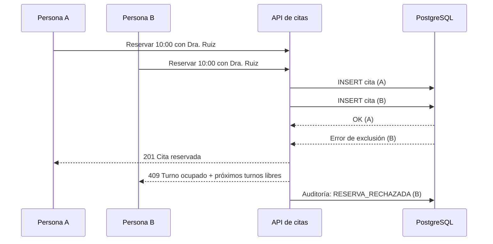
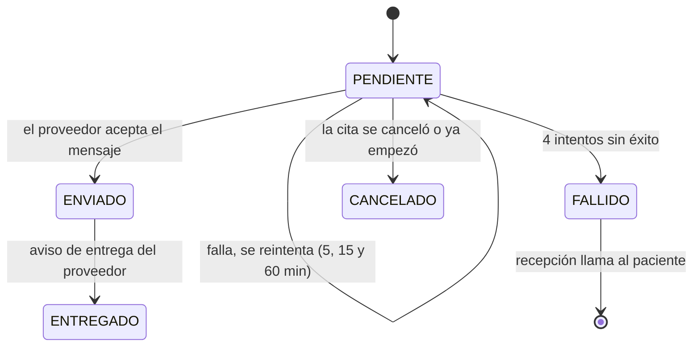

# Sistema de citas médicas

Una clínica administra hoy sus citas por teléfono y hojas de cálculo: hay reservas duplicadas y pacientes que no reciben recordatorios. Este sistema permite **buscar disponibilidad, reservar, cancelar y enviar recordatorios**, con una sola agenda y un registro de cada acción.

**Demo interactiva:** `docs/index.html` (publicada con GitHub Pages). Permite cambiar de rol, reservar, simular dos reservas simultáneas, cancelar, avanzar la hora del sistema y ver cómo se reintentan los recordatorios.

## 1. Arquitectura

**Monolito modular** (Spring Boot + PostgreSQL). Una clínica no necesita microservicios: es un solo equipo, un solo despliegue, y la regla más importante (no duplicar un turno) se resuelve mejor con una transacción local en la base de datos.

| Módulo | Responsabilidad |
|---|---|
| `agenda` | Profesionales, horarios, bloqueos (vacaciones) y cálculo de turnos libres |
| `citas` | Reservar, reprogramar, cancelar, registrar asistencia |
| `pacientes` | Datos mínimos de contacto y consentimiento para recordatorios |
| `recordatorios` | Programación, envío y reintentos |
| `auditoria` | Registro de solo inserción de cada acción |
| `seguridad` | Usuarios, roles y permisos |

**Stack:** Spring Boot 3 (Java 21), PostgreSQL 16, interfaz web, correo por SMTP y SMS por un proveedor externo detrás de una interfaz (`CanalMensajeria`), Docker Compose.

**Sin RabbitMQ ni Redis:** los recordatorios se programan en una tabla de PostgreSQL y un proceso programado los envía. El volumen de una clínica no justifica otra pieza de infraestructura. Se evaluaría RabbitMQ si hubiera varios sistemas consumiendo eventos de citas, y Redis solo si se midieran consultas de disponibilidad lentas.

## 2. ¿Cómo se impide que dos personas reserven el mismo horario?

La garantía vive **en la base de datos**, no en la pantalla ni en el código de la aplicación, porque dos solicitudes pueden llegar al mismo milisegundo.

1. **Restricción de exclusión en PostgreSQL** (`sin_solape_profesional` en `db/init.sql`): rechaza dos citas activas del mismo profesional cuyos rangos de tiempo se solapen. Es atómica: aunque dos personas pulsen «Reservar» a la vez, solo una transacción gana.
2. La aplicación atrapa el error y responde **409 Conflict** con los próximos turnos libres del profesional, para que la persona elija otro sin empezar de cero.
3. **Segunda restricción por paciente** (`sin_solape_paciente`): un paciente no puede tener dos citas a la misma hora con distintos profesionales.
4. **Bloqueo optimista** (columna `version`): si recepción y el paciente editan la misma cita a la vez, la segunda modificación se rechaza en lugar de pisar a la primera.
5. La lista de turnos libres es **informativa**: nunca se confía en ella. La reserva vuelve a validar siempre.



## 3. ¿Qué datos médicos conviene guardar y cuáles no?

**Principio:** guardar solo lo necesario para dar la cita y avisar al paciente. La historia clínica vive en el sistema clínico, no aquí.

| Se guarda | No se guarda |
|---|---|
| Nombre y cédula (para identificar al paciente) | Diagnósticos, historia clínica, resultados |
| Correo y teléfono, canal preferido | Síntomas o «motivo de consulta» en texto libre (suele contener datos sensibles) |
| Consentimiento para recordatorios y fecha en que lo dio | Medicación, alergias, fotos de documentos |
| Profesional, fecha, hora y estado de la cita | Datos de tarjetas de pago |
| Tipo de consulta de un **catálogo** (primera consulta, control, procedimiento menor) | Contenido clínico dentro de los mensajes de recordatorio |

- La fecha de nacimiento se pediría solo si una especialidad lo exige (por ejemplo, pediatría).
- Los recordatorios dicen fecha, hora y lugar, **sin especialidad ni detalles clínicos**.
- Los datos de salud son una categoría especial de datos personales. En Ecuador aplica la Ley Orgánica de Protección de Datos Personales: conviene confirmar finalidad, consentimiento y plazos de conservación con asesoría legal.
- Protección técnica: conexión cifrada (TLS), disco de la base de datos cifrado, contraseñas con hash y copias de respaldo con acceso restringido.

## 4. ¿Quién puede ver, modificar o cancelar una cita?

Principio de **mínimo privilegio**, verificado **en el servidor** (ocultar botones en la pantalla no basta).

| Acción | Paciente | Profesional | Recepción | Administrador |
|---|---|---|---|---|
| Ver citas | Solo las suyas | Solo su agenda | Todas | Todas, con nombres abreviados |
| Reservar | Para sí mismo | No | Para cualquier paciente | No |
| Reprogramar | Las suyas | No | Cualquiera | No |
| Cancelar | Las suyas, hasta 2 h antes | No | Cualquiera, con motivo | No |
| Registrar asistencia o ausencia | No | Las suyas | Cualquiera | No |
| Ver teléfono y correo del paciente | No | No | Sí | No |
| Configurar horarios y profesionales | No | No | No | Sí |
| Ver la auditoría | No | No | No | Sí |

Además, **cada consulta del listado de pacientes por parte del personal queda registrada** en la auditoría.

## 5. ¿Cómo se reintenta un recordatorio que no se pudo enviar?

Cada cita genera recordatorios programados (24 h y 2 h antes) en la tabla `recordatorio`. Un proceso programado, que corre cada minuto, toma los pendientes con `SELECT ... FOR UPDATE SKIP LOCKED` (si hubiera dos instancias, no se pisan) y los envía.



- **Espera creciente:** 5, 15 y 60 minutos entre intentos, con un máximo de 4.
- **Cambio de canal:** en el segundo fallo se prueba por el otro canal (SMS o correo).
- **Sin duplicados:** la tabla tiene `UNIQUE (cita_id, programado_para)` y se guarda el identificador del mensaje del proveedor.
- **Sin mensajes absurdos:** no se envía nada si la cita se canceló, se reprogramó o ya empezó.
- **Al agotar los intentos:** queda `FALLIDO` y aparece en la lista de recepción para llamar por teléfono.
- **«Enviado» no es «entregado»:** el proveedor avisa la entrega por un webhook y solo entonces cuenta como entregado.
- Solo se envían recordatorios a pacientes que **dieron su consentimiento**.

## 6. ¿Qué información debe quedar registrada para auditoría?

La tabla `auditoria` es **de solo inserción** (reglas que impiden `UPDATE` y `DELETE`). Cada registro incluye:

- **Quién:** usuario, rol y canal (web, recepción o sistema), más la IP.
- **Cuándo:** fecha y hora.
- **Qué:** acción (cita creada, reprogramada, cancelada, confirmada, asistencia o ausencia, reserva rechazada por conflicto, consulta de pacientes, recordatorio enviado, reintentado, fallido o entregado, cambio de canal, cambio de consentimiento).
- **Sobre qué:** entidad y cita afectada.
- **Valores anteriores y nuevos** (por ejemplo, el horario antes y después de reprogramar) y el **motivo** de cancelación.
- **Identificador de correlación**, para seguir una solicitud completa.

No se registra contenido clínico ni el texto completo de los mensajes.

## 7. Métricas

| Métrica | Cómo se calcula |
|---|---|
| Citas duplicadas | Citas activas que se solapan: **debe ser 0** (la restricción lo garantiza). Se mide también cuántos intentos de doble reserva se bloquearon |
| Ausencias | `AUSENTE / (ASISTIO + AUSENTE)` |
| Tiempo para encontrar un turno | Desde que se abre la búsqueda hasta que se crea la cita |
| Recordatorios entregados | `ENTREGADO / recordatorios no cancelados` |

```sql
SELECT date_trunc('week', inicio) AS semana,
       count(*) FILTER (WHERE estado = 'AUSENTE')::float
         / NULLIF(count(*) FILTER (WHERE estado IN ('ASISTIO','AUSENTE')), 0) AS tasa_ausencia
FROM cita GROUP BY 1 ORDER BY 1;
```

## 8. Cómo ejecutar

```bash
docker compose up --build     # db + mailpit + backend
```

- Salud del backend: http://localhost:8080/actuator/health
- Correos de desarrollo (Mailpit): http://localhost:8025
- `.env` se versiona con valores de ejemplo. Las claves reales van en `.env.local` o `.env.production`, que están en `.gitignore`.
- El proveedor de SMS no está en el compose: `SMS_API_URL` apunta a un servicio que debes proveer.

## 9. Estructura del repositorio

```
citas-medicas/
├── .env                      Variables de entorno (valores de ejemplo)
├── .gitignore
├── Dockerfile                Imagen del backend (multi-stage, usuario no root)
├── docker-compose.yml        db + mailpit + backend
├── api/openapi.yaml          Contrato de la API
├── db/init.sql               Esquema (con restricciones anti-solape) y datos ficticios
├── backend/                  Esqueleto Spring Boot
└── docs/index.html           Simulador para GitHub Pages
```

## 10. Siguientes pasos

- Implementar en orden: agenda y disponibilidad → reserva con la restricción → roles → auditoría → recordatorios con reintentos → webhook de entrega.
- Prueba de concurrencia: 20 solicitudes simultáneas al mismo turno deben producir exactamente una cita.
- Definir con la clínica la política de cancelación (2 horas es un valor inicial) y los plazos de conservación de datos.
